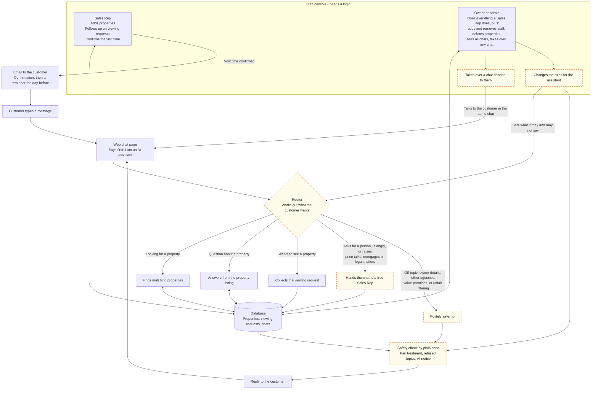

# PropDesk flow

This is the plan from SPEC.md, drawn as a picture. Solid boxes already exist in some form. Dashed boxes are not built yet.

## How to read it

- **Solid boxes** exist today in some form: the chat page, finding properties, answering questions, collecting a viewing request, the database, the staff console for properties and bookings, and the emails.
- **Dashed orange boxes** are in SPEC.md but not built yet: the router, the handover to a Sales Rep, the polite refusals enforced in code, the safety check, chat takeover, and editing the assistant's rules.
- **Also not built yet, though drawn as solid:** separate Sales Rep and Owner/admin logins, saving chat history, and a Sales Rep (not the system) confirming the visit time. Today every staff login can do everything, chats are not saved, and a viewing is confirmed instantly.
